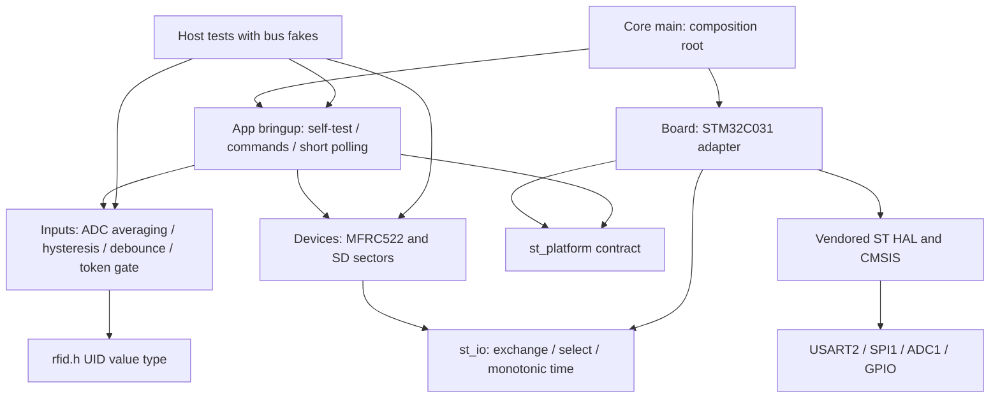

# Архітектура ЛР2 ShiftToken

Склад прикладного продукту не підмінено тестовим стендом: `bringup.c` тільки перевіряє обладнання і демонструє вхідні події; він не відкриває сесій, не рахує робочі інтервали і не зберігає журнал переходів. Ці функції лишаються ЛР3. `sdwrite` пише справжній сектор127 через SPI і перевіряє його читанням; це не RAM-журнал і не штучна затримка.

- Core зберігає startup/IRQ/syscalls зі стартової заготовки, main інжектує `st_platform` адаптера в App. Повторна генерація CubeMX не повинна перезаписати App/Devices/Inputs/Board; генерувати в окрему тимчасову папку й переносити лише перевірені зміни HAL/конфігурації.
- Board — єдине місце з HAL handles і pin mapping. UART RX: ISR, SPSC-кільце256 B, явний лічильник втрат; foreground розбирає не більш32 байтів за прохід. TX блокувальний, SPI/ADC з кінцевими timeout, SPI використовує тільки foreground. IRQ не бере SPI.
- Devices працюють тільки через `st_io`, без HAL. Вибір slave утримує CS протягом команди та даних. RF перевіряє VersionReg, довжини, ErrorReg, BCC і CRC_A SELECT/SAK. SD перевіряє CMD8/OCR, R1/data response/busy, адресу й read-back; CRC32 використовується для результату bring-up.
- Inputs: raw→mV за номінальною Vref; 8-точкове середнє, гістерезис4 кодів ±32 counts; invalidation до нового повного вікна; stable-level debounce25 мс; token gate вимагає3 NO_CARD, помилка не підтверджує зняття.
- App бачить лише переносні контракти. Обов’язкові перевірки залежностей в tools/check_layers.py виконуються make test і CI. Жоден App/Inputs/Devices файл не включає HAL, Core або Board.

Єдина 512-байтна SD область є статичною; dynamic allocation у власному коді немає. Стек зарезервовано2048 B, heap512 B зі стартового linker script; це резерв, не виміряний пік. Пік стека/CPU та повна baseline вимірюватимуться у ЛР3. Після помилки RFID не видає UID, повторює init кожну1000 мс; SD fault скидає ready та так само ініціалізується повторно. ADC fault скидає validity і вікно; кнопка утримання дає одну подію. Відсутність картки є NO_CARD, а не fault.

Фінальний RFID додатково зіставляє ATQA UID-size з отриманою довжиною: неузгоджений NFC UID7 моделі відхиляється як PROTOCOL, без TOKEN. Правильні каскади UID4/7 перевіряються host. Повторний WUPA утримуваної картки після HALT у native моделі не підтверджено; token gate не слід трактувати як фізично доведену підтримку цієї поведінки.

Board виконує явні 8-бітні HAL SPI exchanges під одним безперервним CS. Це перевірений workaround спостереженого VersionReg00; packed16-bit RX є ймовірною причиною, а не однозначно встановленим діагнозом. CAPTURE_GATE автоматично відкривається на першу1000мс після старту, далі керується bounded командою capture.

[Схема компонентів](figures/components.png) є рисунком архітектури, не знімком виконання.

Залишкові вимірювальні обмеження: HAL polling та UART/SD можуть розширювати software periods; Wokwi не підтверджує аналогове settling, RF-чутливість, струм або SD power-loss atomicity. Відмова периферії, яку модель не відтворює, перевіряється на host як контракт драйвера і окремо позначається у звіті.
