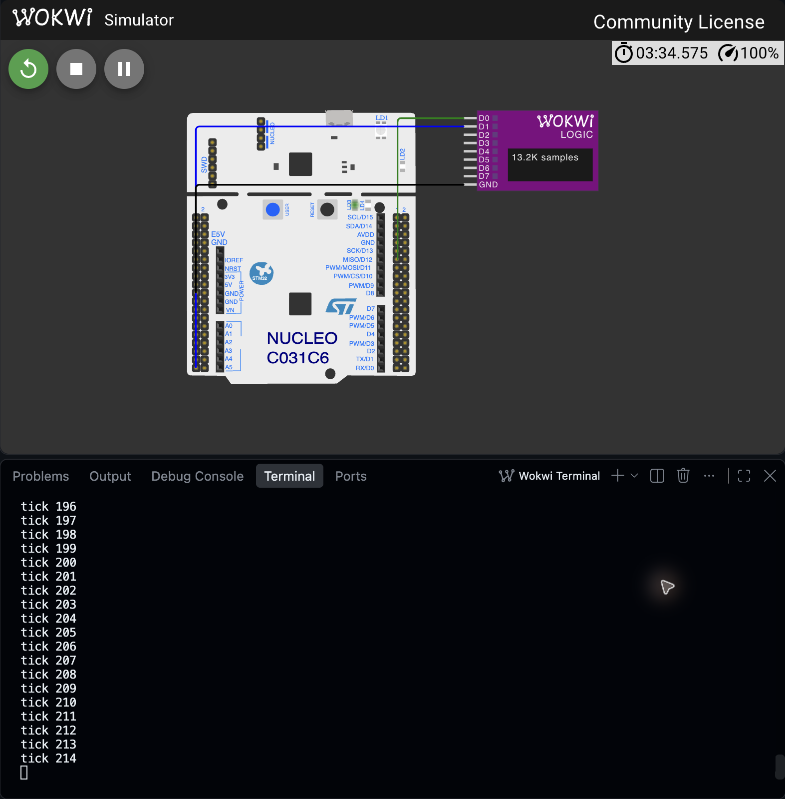
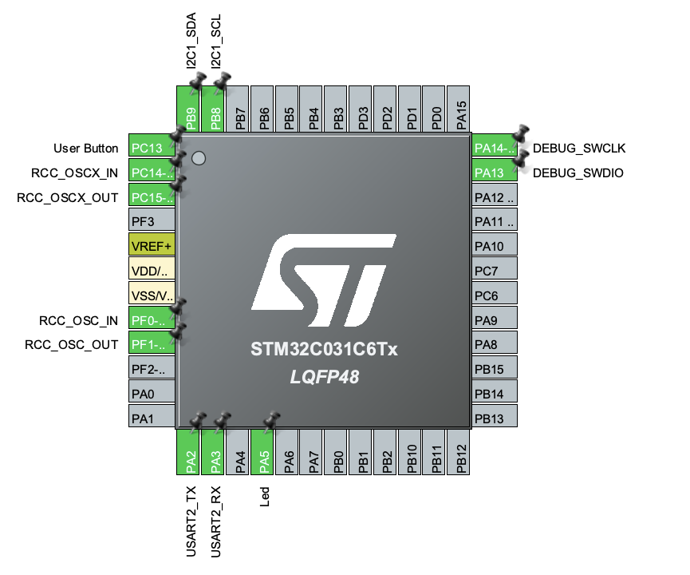
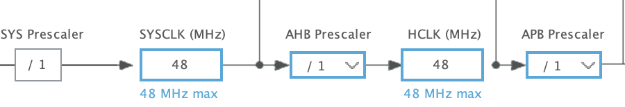

# ShiftToken — ЛР1

## 1. Мета та межі роботи

Отримати відтворюваний шлях від вихідних файлів STM32 до прошивки, яка відповідає через UART і перемикає світлодіод у Wokwi. Для ShiftToken також визначено, які події термінал обліковуватиме і як перевіряти майбутні сесії, паузи та збереження результатів. ЛР1 не включає драйвери RFID або готовий облік часу.

## 2. Продукт і критерії приймання

ShiftToken призначений для навчальної майстерні. Картка задає UID оператора, потенціометр — код роботи 1–4, дві кнопки — паузу та завершення. UID не є захищеним підтвердженням особи. Відкрита лише одна сесія; інша картка має давати конфлікт, а утримання тієї самої не має створювати повторів.

| Вимоги | Критерій майбутнього продукту |
|---|---|
| FR-01, FR-04 | RFID кожні 50 мс; реакція ≤200 мс; 3 NO_CARD поспіль для зняття. |
| FR-02, FR-03 | Свіжість ADC ≤150 мс; debounce 25 мс; кнопка→реакція ≤100 мс. |
| FR-05, FR-06 | Окремі active_ms/pause_ms, похибка межі ≤1 мс; fault не створює картку; відновлення ≤1500 мс. |
| FR-07 | UART 115200 8N1; відповідь на коротку команду ≤200 мс, export ≤3 с. |
| FR-08 | microSD, CRC32 і read-back; підтвердження запису ≤500 мс; reset не додає вигаданий час. |

Ці числа є проєктними критеріями для людино-керованого термінала. Вони ще не підтверджують виконання FR. Повний документ docs/PRD.md містить вісім вимог, правила валідності, відмови та окремі тести. У ЛР2 перевіряються входи і сховище; в ЛР3 — продукт як ціле, в ЛР4 — порівняння з FreeRTOS.

## 3. Компоненти та альтернативи

| Вузол | Рішення і причина |
|---|---|
| MFRC522 / SPI | Зчитування 4/7-байтових UID. Mode0, 3,3 В, VersionReg 0x37. PN532 має складніший протокол; введення UID через UART не перевіряє RF-вузол. |
| Кнопки / GPIO | Окремі PAUSE і CLOSE, active-low. Одна кнопка з довгим натисканням робить завершення повільнішим. |
| Потенціометр / ADC | Лінійний 10 кОм, 0–3,3 В, 12 біт, коди роботи 1–4. Клавіатура потребує більше GPIO і не перевіряє ADC. |
| microSD / SPI | Постійне сховище наступного етапу: окремий CS, 512-байтовий буфер, без FAT. RAM непридатна; внутрішня flash не вважається перевіреною без досліду. |

Первинні джерела та конкретні сторінки: docs/hardware-components.md. Для апаратного стенда потрібні вимірювання рівнів, споживання та піків SD/антени. Wokwi не підтверджує запас живлення.

## 4. Середовище та збірка

Середовище проєкту: Ubuntu 24.04, Docker, STM32 HAL, Wokwi. Збережено Nucleo-C031C6 з Cortex-M0+, 48 МГц, 32 КБ flash і 12 КБ RAM. Використано дозволений SP-Boilerplate на основі офіційного прикладу Wokwi STM32; збережено ліцензії ST/CMSIS. Вихідна конфігурація .ioc включає USART2, GPIO і I²C1. На цьому етапі датчики не підключені.

Команда make build створює окремий Docker-образ shifttoken-build:lab12 і запускає ARM GCC у /workspace від UID/GID власника. Після make clean виконано дві повні збірки. arm-none-eabi-gcc: 13.2.1; пакети та версії збережено у docs/evidence/lab1/toolchain.txt. Збірка на macOS є запуском Linux-контейнера, а не нативною ARM-збіркою macOS.

| Артефакт | Результат порівняння |
|---|---|
| ELF / HEX / BIN | SHA-256 двох чистих збірок збігаються побайтно. |
| ELF SHA-256 | cf8b74a12fa808b00127844bbe7607421676d4e09508724c0c81cbfd6d2734af |
| Flash / RAM за size | text 12980 B, data 112 B, bss 2120 B; це секції, а не виміряний пік стека. |
| Логи | build1.log, build2.log, hash1.txt, hash2.txt; reproducibility.diff порожній. |

USART2 працює на PA2/PA3, 115200 8N1. У main.c передано printf через __io_putchar до HAL_UART_Transmit. Вбудований LED PA5 перемикається у циклі, після виводу tick виконується HAL_Delay(1000). Базова .ioc збережена; нова генерація CubeMX для ЛР1 не була необхідна. Конфігурацію відкрито в CubeMX 6.18.1 у режимі Continue, зі збереженням HAL v1.0.1; міграцію та повторну генерацію коду не виконано. Експорт pinout CSV узгоджується з .ioc.

Технічна зміна та докази: 675fbe0 — збірка, UART, LED і власні результати. Вимоги: 9a368b8 — PRD і дослідження компонентів.

## 5. Перевірка пристрою в Wokwi

Прошивка запущена у встановленому Wokwi for VS Code 4.1.0 з існуючою Community License. UART збережено через окремий RFC2217-порт 4049. Після перезапуску отримано банер ShiftToken lab1 ready з sysclk_hz=48000000 і послідовність tick 0, 1, 2, 3, 4. Сирі байти та текст збережено у uart-restart.raw і uart-restart.txt. Вони відокремлені від результатів компіляції.

Логічний аналізатор підключений до PA5 та PA2. У завершеному VCD перевірено 320 внутрішніх періодичних інтервалів LED: min 1000.978 мс, avg 1001.957 мс, max 1001.981 мс. Початкові переходи налаштування та край зупинки не входять у статистику. Відхилення від 1000 мс пояснює блокувальний UART та код циклу; це причина змінити організацію опитування у ЛР2.

Час наведено за сигналами симулятора. Роздільність VCD 1 нс не означає таку точність фізичного STM32. Реальна плата, частота RC-генератора й електричні фронти не перевірялися.

## 6. Реальний запуск стенда

## 7. Перевірка збереженої конфігурації

## 8. Журнал перевірених складнощів

| Симптом і причина | Виправлення / результат |
|---|---|
| Заготовка не ідентифікувала продукт у UART. Загальний банер STM32 не давав зрозуміти, яка копія працює. | Додано ShiftToken, частоту ядра й параметри UART; банер фактично зчитано після reset. 675fbe0. |
| Типовий тег образу збірки був спільним для різних проєктів. | Обрано окремий shifttoken-build:lab12; логи містять його створення та запуск. 675fbe0. |
| CubeMX 6.18.1 пропонував мігрувати .ioc з CubeMX 6.8.1 / HAL v1.0.1. Автоматичне оновлення змінило б базу прошивки. | Обрано Continue без міграції. Отримано справжні Pinout/Clock Configuration і CSV; вихідна .ioc збережена. |
| Wokwi CLI не запускався через відсутній CI-токен. Ліцензія VS Code і CLI-токен — різні механізми. | Використано встановлене розширення з чинною ліцензією; отримано справжній UART/VCD. Стан ліцензії не змінювався. |
| Після restart експорт VCD містив лише стартовий фрагмент близько 33 мс. | Цей файл збережено як неповний. Повний запис отримано явною зупинкою, перевірено тривалість і періодичні переходи. 675fbe0. |
| Секундний HAL_Delay давав LED-інтервал до 1001,981 мс, а не рівно 1000 мс. | Затримка UART входить у період. Для ЛР1 це виміряний результат; у ЛР2 потрібні короткі окремі періоди замість секундного блокування. |

## 9. Висновки та наступний етап

Отримано відтворювану Docker-збірку і перевірено, що саме її прошивка працює у Wokwi: є стартовий UART, послідовні tick та незалежні GPIO-переходи LED. З’ясовано ціну блокувального виводу: період циклу довший за сам HAL_Delay. Сформовано вісім вимог до ShiftToken та правила приймання, які не підміняють результатів майбутніх лабораторних. Наступний крок — одночасний bring-up RFID, ADC, кнопок і реального блочного сховища.

## 10. Джерела

1. ST DS13867 rev4: STM32C031x4/x6, с.1, 31–38, табл.12–20. 2. ST RM0490, розділи GPIO/SPI/ADC/USART. 3. ST UM2953, плата MB1717, живлення та роз’єми. 4. NXP MFRC522 rev3.9, с.10–12, 66, 74–79. 5. Bourns PTV09, с.1–2. 6. Omron B3F, с.2–3. 7. SD Association Physical Layer Simplified Specification, SPI mode. Повні посилання зберігаються у hardware-components.md.

8. Wokwi STM32 HAL starter. 9. Wokwi Nucleo-C031C6. 10. Wokwi logic analyzer. 11. wokwi.toml і RFC2217.

